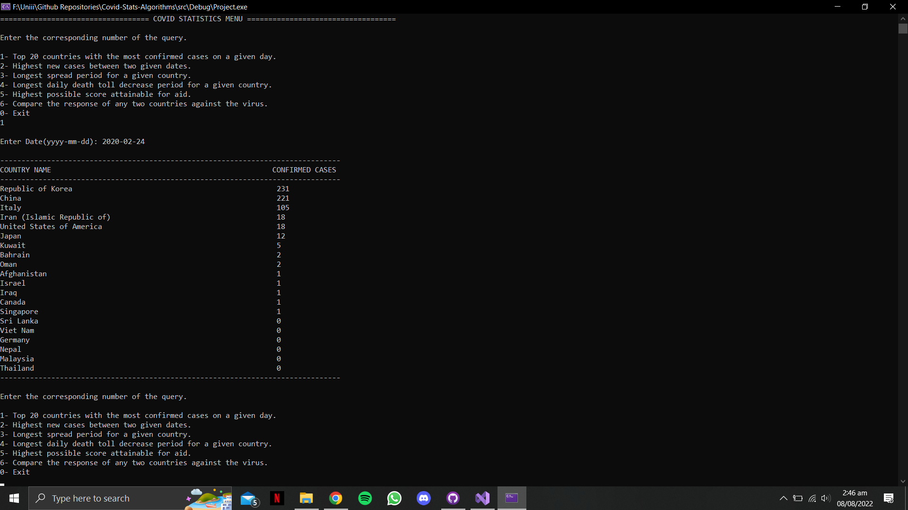
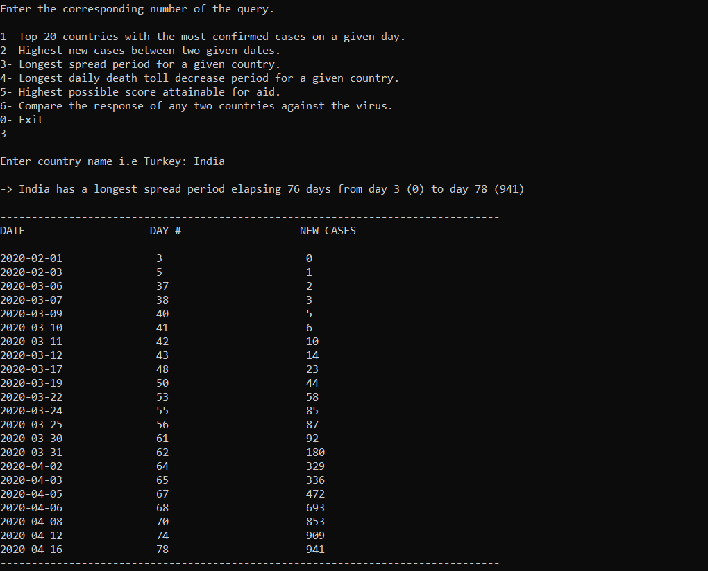
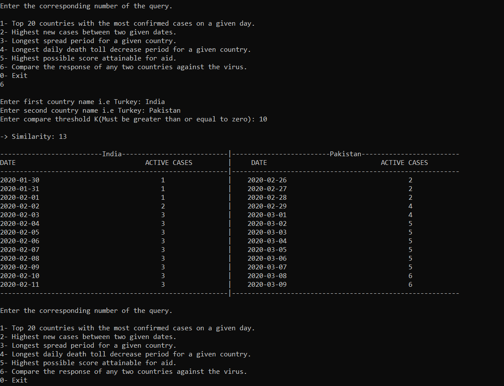

# Pandemic Analytics

A C++ data-analysis project that applies classical algorithms to World Health Organization COVID-19 data to answer ranking, trend, allocation, and similarity questions.

[](https://github.com/SameetAsadullah/pandemic-analytics/actions/workflows/quality.yml)
[](LICENSE)

## Analyses

| Query | Technique |
|---|---|
| Top 20 countries by confirmed cases on a date | Priority queue / heap |
| Highest new-case count in a date range | Priority queue and date filtering |
| Longest increasing spread period | Longest increasing subsequence |
| Longest decline in daily deaths | Longest decreasing subsequence |
| Highest-scoring aid allocation under a capacity | 0/1 knapsack |
| Similarity between two national response series | Longest common subsequence |

## Repository layout

- `src/main.cpp` — interactive query menu
- `include/query_1.h` through `include/query_6.h` — the six analysis implementations
- `include/functions.h` — shared validation and display helpers
- `data/who-covid-19.csv` — input observations
- `data/country-weights.csv` — weights used by the aid-allocation query
- `extras/` — example program output

`experiments/edit-distance.cpp` is retained as a separate algorithm experiment and is not part of the primary executable.

## Build and run

```bash
make
./build/covid-stats
```

Run the executable from the repository root so it can locate the CSV inputs.

## Data

The included `data/who-covid-19.csv` is a historical analysis snapshot. Replace it with data using the same column layout to explore another period. Results should be understood in the context of the dataset date and are not current public-health guidance.

## Screenshots

| Menu | Query result | Analysis result |
|---|---|---|
|  |  |  |

## Project status

The algorithm implementations are maintained with portable build instructions, focused documentation, and generated-file hygiene.

## License

Released under the [MIT License](LICENSE).
